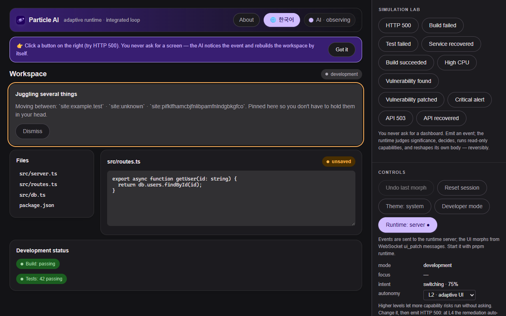

# Particle AI

컴퓨터 위에 씌우는 **AI 레이어**입니다. 어떻게 일하는지를 관찰해 지금 무엇을 하려는지 항상 추론하고, 무언가 깨지기 전에, 깨지지 않아도 자기 인터페이스를 사용자에게 맞춰 재구성합니다.

AI에게 소프트웨어를 *사용하게* 하는 대신, AI가 소프트웨어 자체가 됩니다.

실험용 연구 소프트웨어입니다. 운영 환경에 쓰지 않습니다.

[English README](README.md), [퀵스타트 5분 체험](QUICKSTART.md)

## 앞으로 가는 방향

제품을 다시 정의하는 중입니다. 목표는 개발 신호를 내놓는 앱만이 아니라 **모든 앱**을 읽고, 요청하면 대신 조작까지 하는 층입니다. 계획과 그 계획이 강제하는 결정 네 가지, 작업 순서는 [`docs/DESIGN_V2.md`](docs/DESIGN_V2.md) 에 있습니다.

**그 계획은 아직 하나도 구현되지 않았습니다.** 아래 내용은 지금 실제로 도는 범위입니다.

## 핵심 아이디어

기존 생성형 AI는 프롬프트를 받아 모델이 응답하는 구조입니다. Particle AI는 대신 다음 루프를 계속 돕니다:

```
관찰 → 이해 → 중요도 평가 → 의도 추론 → 결정
→ 지능 선택 → 능력 선택 → 실행 → 인터페이스 변형(morph)
→ 결과 관찰 → 반복
```

인터페이스는 AI의 **몸**이고, 행동은 AI의 감각입니다. 자리를 비웠다 돌아오면 복귀 요약이 기다리고 있고, 같은 행동을 세 번 반복하면 관련 컨텍스트가 작업 옆에 나타나고, 두 파일을 계속 오가면 그 둘이 고정됩니다.

의존하는 서비스가 실패하기 시작하면 통신의 내용이 아닌 *형태*로 읽어 연결 화면이 열리고, 복구되면 스스로 닫힙니다. 빌드 실패와 HTTP 500 같은 에러는 그 가운데 한 경우일 뿐이고, 사용자가 "에러 대시보드 보여줘"라고 말하는 일은 한 번도 없습니다.

되돌리기는 피드백입니다. 같은 종류의 변경을 두 번 닫으면 더 이상 제안하지 않습니다.

감각이 오는 곳은 레이어마다 따로 켭니다. 열두 계층 가운데 열 개는 형태만 읽습니다.

나머지 둘은 내용을 읽고, 둘 다 켜기 전까지는 꺼져 있습니다. 화면 캡처는 적어 둔 앱의 창 안을 읽고, 찍은 그림을 모델이 읽으려면 스위치가 하나 더 필요하며 그 기본값도 꺼짐입니다.

확장의 페이지 구조 계층은 보고 있는 페이지의 제목, 주요 제목, 입력칸 라벨, 버튼 이름을 읽습니다. 입력한 값과 비밀번호나 카드번호가 들어갈 수 있는 칸은 어느 쪽에서도 보내지 않습니다.

| 레이어 | 센서 | 관찰 대상 |
|---|---|---|
| 이 페이지 | `apps/web` | 클릭, 체류, 유휴, 탭 가시성 |
| 브라우저 | `apps/extension` (MV3) | 탭 포커스, 사이트 호스트명, 상호작용 횟수, 통신 형태(옵트인), 보고 있는 페이지의 구조(옵트인) |
| 데스크톱 | `apps/agent` (Node, 옵트인) | 파일 저장(상대 경로), git 브랜치 전환, 테스트와 빌드의 통과와 실패 전이, 앞에 있는 창. `DM_CAPTURE=1` 과 `DM_CAPTURE_APPS` 를 채우면 그 앱 창의 사진, `DM_SCREEN_READ=1` 까지 채우면 그 사진을 모델이 읽은 결과 |

바디는 센서들이 스스로 보고한 내용으로 *지금 무엇을 감지 중인지* 항상 표시합니다.

```
   이 페이지          브라우저                데스크톱
  apps/web        apps/extension (MV3)     apps/agent (옵트인)
  클릭·체류        탭·호스트·통신 형태        파일 저장·git 브랜치
  유휴·복귀        (옵트인)                  테스트/빌드 전이
      │                  │                        │        기본값에서는
      └────────── 순서 보존·직렬화된 이벤트 ───────┘        형태만 보냅니다
                             ▼
                ┌─ Particle AI 런타임 (로컬) ────┐
                │ 월드 모델 → 유의성             │   모든 결정 감사 가능,
                │ → 의도(상시) → 두뇌            │   모든 변형 되돌리기 가능,
                │ → 권한 → 능력                 │   이벤트 소싱 리플레이
                │ → 모프 가드 → 재조정           │
                └───────────────┬───────────────┘
                                ▼
                     바디 (apps/web / 사이드패널)
              무언가 깨지기 전에 스스로 재구성하고,
              닫기에서 배우고, 감지 중인 것을 정직하게 표시
```

안전을 보장하는 가드레일:

- 모델은 **검증된 UI 데이터**(`UIBlueprint` / `UIPatch`)만 내보내며, 실행 가능한 코드는 절대 생성하지 않습니다.
- **Morph Guard**가 UI가 튀지 않도록 막습니다. 쿨다운, 머무른 시간, 포커스 보호, 미저장 작업 보호입니다.
- 모든 변형은 되돌릴 수 있고, 모든 결정은 감사할 수 있습니다.
- 전체가 **결정론적 mock 모드**로 API 키 없이 돌아갑니다.
- 프로바이더는 추상화되어 있어 Anthropic, OpenAI, 로컬 모델을 코어 수정 없이 교체할 수 있습니다.
- 반복되는 상황은 **패턴으로 감지**되어 재사용 템플릿 후보로 제안됩니다(자동 변형은 하지 않음).



## 빠른 시작

```bash
pnpm install
pnpm test          # 유닛/통합 테스트
pnpm web           # http://localhost:3000 (다른 포트: pnpm --filter @particle/web start -- -p 4000)
pnpm runtime       # http://localhost:8787 (connected 모드용 백엔드 런타임)
```

API 키가 필요 없습니다. 기본은 결정론적 mock 프로바이더입니다.

실제 프로바이더를 켜려면 `.env.example`을 `.env`로 복사하고 키를 넣으세요(`ANTHROPIC_API_KEY` 등). 서버는 자동으로 실제 두뇌를 사용하며 `GET /api/brain`에서 활성 프로바이더를 확인할 수 있습니다.

## 화면에서 확인하기

1. `pnpm web` 을 띄우고 **http://localhost:3000**(또는 4000)을 엽니다.
2. 우측 Simulation Lab 에서 `HTTP 500` 을 누르면, 아무 요청도 하지 않았는데 런타임이 인시던트 워크스페이스로 스스로 변형합니다. 에디터의 미저장 작업은 보존됩니다.
3. `Service recovered` 를 누르면 개발 화면으로 돌아오고, `Undo last morph` 로 되돌립니다.
4. `High CPU` 와 `Critical alert` 는 현재 맥락과 무관하므로 모프가 일어나지 않습니다.
5. Developer mode 를 켜면 이벤트 트레이스, 월드 상태, 결정, 메모리, 감사 기록이 보입니다. 결정론을 확인하는 `Replay & verify` 버튼도 여기 있습니다.
6. Runtime 토글을 local 에서 server 로 바꾸면, `pnpm runtime` 이 떠 있을 때 백엔드 WebSocket 의 `ui_patch` 로 UI 가 변형됩니다.
7. 상단 AI 상태 칩을 누르면 AI 가 무엇을 관찰하고 계획하는지, 왜 바꿨는지 팝오버로 보입니다.
8. 변형 기록 스트립의 단계를 누르면 그 이전으로 여러 단계 되돌립니다. 새로고침해도 이벤트 로그 재생으로 세션이 복원됩니다.
9. `Vulnerability found` 는 CVE 테이블이 있는 보안 경보 레이아웃과 의존성 업데이트 승인 흐름을 띄웁니다.
10. 우측 상단의 지구본 버튼으로 전체 UI 언어를 한국어와 English 사이에서 바꿉니다.

## 브라우저 확장 (Concept v2)

Particle AI는 한 페이지가 아니라 **브라우저 전체에 씌우는 레이어**입니다. `apps/extension`(MV3)이 탭 포커스, 이동한 사이트의 호스트명, 상호작용 횟수, 유휴 시간을 감지하고, 어떤 사이트에서든 사이드 패널에 바디를 띄웁니다.

통신의 *형태*는 옵트인입니다. 호스트와 상태코드, 지연시간만 보내고 경로와 쿼리, 본문은 보내지 않습니다.

```bash
pnpm --filter @particle/extension build   # -> apps/extension/dist
pnpm dev                                  # 런타임 :8787 + 바디 :3000 (또는 터미널 두 개에서 `pnpm runtime` / `pnpm web`)
```

1. `chrome://extensions` 에서 개발자 모드를 켜고 **압축해제된 확장 프로그램 로드** 로 `apps/extension/dist` 를 올립니다.
2. 확장 아이콘을 누르면 사이드 패널이 `http://localhost:3000/?connect=1&session=ext` 로 열리고 런타임에 자동으로 연결됩니다.
3. 아이콘을 우클릭해 옵션을 열면 감지 레이어마다 동의를 켜고 끕니다.

자세한 내용: [`apps/extension/README.md`](apps/extension/README.md), [`docs/CONCEPT_V2.md`](docs/CONCEPT_V2.md)

## 데스크톱 에이전트 (옵트인)

`apps/agent`는 감지를 에디터와 터미널까지 넓히고, 여기서도 형태만 봅니다. 파일을 **저장**한 사실(상대 경로만)과, 파이프로 받은 출력에서 테스트와 빌드가 통과에서 실패로, 실패에서 통과로 바뀐 전이입니다.

같은 파일을 반복 저장하면 막혀 있다는 컨텍스트 카드가, 테스트가 실패하면 테스트 실패 레이아웃이 작업 옆에 나타나고 다시 통과하면 스스로 사라집니다.

```bash
DM_WATCH_PATHS=. pnpm agent      # 파일 저장 감지
pnpm test 2>&1 | pnpm agent      # 실행 결과 전이 감지 (출력은 그대로 터미널에 표시)
```

바디: `http://localhost:3000/?connect=1&session=desktop`. 자세한 내용: [`apps/agent/README.md`](apps/agent/README.md)

## 화면 캡처 (기본 꺼짐)

에이전트의 창 감시는 윈도우 접근성 창구로 창을 읽는데, 그 프로그램이 답할 때만 됩니다. 윈도우 11에서 확인한 결과입니다.

한셀은 메뉴와 버튼 이름이 전부 나옵니다. 카카오톡은 이름 없는 상자 여섯 개만 나오고 대화 목록도 메시지도 나오지 않습니다. 답하는 함수를 만들어 두지 않았기 때문입니다.

그런 창은 그림으로 읽는 수밖에 없습니다. `packages/screen-capture` 는 창 하나를 찍어 png 로 씁니다. 손으로 한 장 찍는 방법입니다.

```bash
DM_CAPTURE=1 pnpm --filter @particle/screen-capture exec tsx src/bin.ts --app KakaoTalk
```

센서로 쓰는 방법은 데스크톱 에이전트의 화면 계층입니다. 스위치 두 개와 앱 목록이 필요합니다.

```bash
DM_WATCH_WINDOWS=1 DM_CAPTURE=1 DM_CAPTURE_APPS=KakaoTalk pnpm agent
```

목록에 적은 앱 창에 들어가 있는 동안 앱당 최대 1분에 한 장을 찍고, 적지 않은 프로그램의 창은 찍지 않습니다. 아무 설정도 안 하면 저장소는 지금까지와 똑같이 동작합니다.

찍은 그림은 파일 이름으로만 돌아다닙니다. 픽셀은 찍은 컴퓨터의 `DM_CAPTURE_DIR`(비어 있으면 임시 폴더)에 직접 지울 때까지 남습니다. 런타임에는 사진을 찍었다는 사실과 어느 앱인지, 파일 위치가 갑니다(`sensor.captured_window`).

계층이 도는 동안 바디는 `screen: KakaoTalk` 처럼 어느 앱을 찍는지까지 표시하고, 이 계층의 동의 문구를 함께 보여줍니다. 결정 근거는 [`docs/CONSENT_V2.md`](docs/CONSENT_V2.md), 자세한 내용은 [`apps/agent/README.md`](apps/agent/README.md) 입니다.

## 찍은 그림을 모델이 읽기 (스위치 하나 더, 역시 기본 꺼짐)

```bash
DM_WATCH_WINDOWS=1 DM_CAPTURE=1 DM_CAPTURE_APPS=KakaoTalk DM_SCREEN_READ=1 pnpm agent
```

`DM_SCREEN_READ` 를 켜면 찍은 그림을 모델에 넘겨 읽힙니다. 모델은 검증된 데이터를 돌려줍니다. 창이 어떤 상황인지(`messaging`, `error`, `waiting` 등 정해진 낱말 하나), 한 문장 요약, 주제 몇 개, 사람을 기다리는 중인지, 얼마나 확신하는지입니다.

이 결과가 `sensor.screen_read` 로 갑니다. 모델이 줄글로 답하거나 정해지지 않은 낱말을 쓰면 읽기 결과는 없고 아무것도 보내지 않습니다. 스키마는 `packages/contracts/src/screen.ts` 입니다.

캡처와 스위치를 따로 둔 이유는 동의할 대상이 다르기 때문입니다. 픽셀이 디스크를 떠나는 지점이 여기입니다.

API 키가 없으면 결정론적 모의 제공자가 읽고, 그 제공자는 픽셀을 보지 않으므로 그림은 컴퓨터 밖으로 나가지 않습니다. 키가 있으면 그 제공자에게 그림이 갑니다.

에이전트는 시작할 때 어느 제공자가 읽을 수 있는지 한 줄로 알리고, 한 장을 읽을 때마다 실제로 읽은 제공자를 알립니다. `DM_SCREEN_READ` 를 지우면 그림은 찍히기만 하고 아무도 읽지 않습니다.

## 이벤트 보내기

`POST /api/events` 는 그 이벤트 하나로 루프 전체를 돌립니다. 월드, 중요도, 의도, 모델 호출, 권한, 능력, 모프까지 끝낸 뒤에 결과를 돌려줍니다. 바디가 원하는 동작이고 지금도 기본값입니다.

센서는 그 답을 읽지 않습니다. 확장과 데스크톱 에이전트는 방금 관찰한 것을 보고할 뿐인데 루프가 끝날 때까지 연결을 붙잡고 있었습니다. 모델 호출 한 번이 느리면 그동안 센서가 멈춥니다. 그래서 둘 다 `?wait=0` 으로 보냅니다.

| 요청 | 응답 |
|---|---|
| `POST /api/events` | `200`. 월드 상태, 결정, 모프를 그대로 돌려줍니다 |
| `POST /api/events?wait=0` | `202 {"accepted":true,"eventId":"..."}`. 이벤트는 앞선 것들 뒤에서 실행됩니다 |
| `POST /api/events?wait=0` + 형식이 틀린 이벤트 | `400`. 답을 기다리지 않아도 형식이 틀렸다는 사실은 그 자리에서 알려 줍니다 |

철자는 `?wait=0` 하나입니다. `wait=false` 는 쓴 사람에게 "기다리지 마라"로 읽히므로 추측하지 않고 거절합니다.

어느 쪽이든 한 세션의 이벤트는 받은 순서대로 한 번에 하나씩 실행됩니다. 루프는 직전 이벤트가 남긴 믿음 위에 다음 이벤트를 접어 넣기 때문에, 둘이 동시에 돌면 어느 모델 호출이 먼저 답했는지에 따라 바디가 달라집니다. 세션끼리는 서로를 기다리지 않습니다.

| 설정 | 기본값 | 의미 |
|---|---|---|
| `DM_EVENT_QUEUE_MAX` | `100` | 한 세션에서 대기할 수 있는 이벤트 수. 넘으면 오래된 이벤트부터 버립니다 |

밀리면 오래된 이벤트부터 버리고, 버렸다는 사실을 드러냅니다. 해당 세션의 기록에 `events_dropped` 가 남고(`GET /api/sessions/:id/decisions`), 런타임 로그에 한 줄이 남고, `/health` 의 `queue: { waiting, dropped, queueMax }` 에 누적 수가 보입니다. 기다리던 호출자는 `503` 을 받습니다. 실행된 척하는 `200` 을 받지 않습니다.

## 런타임 접근 제어

런타임은 당신이 한 일의 형태 기록을 갖고 있으므로 기본적으로 **당신에게만** 응답합니다:

| 설정 | 기본값 | 의미 |
|---|---|---|
| `DM_HOST` | `127.0.0.1` | 바인드 주소. LAN에 노출하려는 경우에만 `0.0.0.0` |
| `DM_ALLOWED_ORIGINS` | `http://localhost:3000,http://127.0.0.1:3000` | 읽기/쓰기가 허용된 브라우저 출처. `chrome-extension://`은 항상 허용이고, 그 외 페이지는 CORS 허용 없이 403 |
| `DM_INGEST_TOKEN` | *(비움)* | 선택 공유 비밀. 설정하면 모든 읽기와 쓰기에 `x-particle-token` 이 필요하고(WS는 `?token=`), 확장은 옵션 페이지에서, 에이전트는 같은 환경변수로 전달합니다 |

읽기는 세션을 생성하지 않으므로 임의의 id로 실제 세션을 밀어낼 수 없습니다. "형태만"은 열 개 계층에서 강제되며, 런타임은 바디와 확장, 토큰 보유자를 신뢰합니다.

내용을 읽는 두 계층은 그 밖에 있습니다. 화면 계층은 켜고 앱을 적기 전까지 꺼져 있다는 사실과 그림이 런타임으로 가지 않는다는 사실이 강제 수단이고, 그림을 모델에 넘기려면 스위치가 하나 더 필요하며 끄면 그림은 디스크에만 남습니다.

페이지 구조 계층은 켜기 전까지 꺼져 있다는 사실과 보내는 이름의 개수와 길이 상한, 비밀번호와 카드 칸을 아예 빼는 규칙이 강제 수단입니다.

## 데이터 영속화 (선택)

`DATABASE_URL`이 설정되면 이벤트와 스냅샷이 Postgres(Drizzle + postgres-js)에 저장됩니다. 비어 있으면 인메모리 저장소와 결정론적 리플레이로 동작합니다.

compose 파일은 Postgres만 띄웁니다. 런타임과 웹은 터미널에서 그대로 실행합니다.

```bash
docker compose up -d postgres    # 시작 (postgres:16-alpine, CI와 같은 이미지와 설정입니다)
docker compose down              # 중지, 이름 있는 볼륨 dm_pgdata에 데이터가 남습니다
docker compose down -v           # 중지하고 데이터까지 지웁니다
```

런타임은 `DATABASE_URL`을 채워서 평소대로 띄웁니다.

```bash
DATABASE_URL=postgres://dm:dm@127.0.0.1:5432/digital_matter pnpm runtime
```

어느 저장소가 살아 있는지는 `GET /health`가 알려 줍니다. `"backend":"postgres"` 또는 `"backend":"memory"`로 나옵니다.

마이그레이션 파일은 없습니다. 런타임이 접속할 때 `events`와 `snapshots` 테이블을 직접 만듭니다(`packages/persistence/src/pg.ts`의 `ensureSchema`, `CREATE TABLE IF NOT EXISTS`). 빈 데이터베이스에 처음 붙을 때도 따로 할 일이 없습니다.

윈도우에서는 `localhost` 대신 `127.0.0.1`을 씁니다. `localhost`는 IPv6 `::1`로 풀릴 수 있고 거기에는 컨테이너가 떠 있지 않습니다. 5432 포트가 이미 쓰이고 있으면 `DM_PG_PORT`에 비어 있는 포트를 지정하고 `DATABASE_URL`에도 같은 포트를 적습니다.

## 라이선스

[MIT](LICENSE) 입니다. 캡처 기반 두 가지는 라이선스가 갈리도록 일부러 패키지를 나눴습니다.

`packages/screen-capture` 가 기본 경로이고 MIT 이며 윈도우 그리기 API 를 씁니다. `packages/screen-capture-obs` 는 OBS Studio 를 쓰는데 OBS 는 GPL v2 이상이라, 그 패키지가 자기 GPL 라이선스를 따로 들고 있고 기본 빌드는 그 패키지를 import 하지 않습니다. 쓰기로 정하면 GPL 이 함께 따라옵니다.

## 아키텍처

전체 구조는 [`docs/ARCHITECTURE.md`](docs/ARCHITECTURE.md), 런타임 루프는 [`docs/RUNTIME_LOOP.md`](docs/RUNTIME_LOOP.md), 설계 결정은 [`docs/adr/`](docs/adr/), 진행 상황은 [`docs/STATUS.md`](docs/STATUS.md)를 보세요.

내부 패키지는 `@particle/*` 네임스페이스이며, pnpm + Turborepo 모노레포로 구성됩니다.

## 상태

Phase 0–8(런타임, UI 매터, 능력, 메모리, 영속화, 신뢰성) 완료에 더해 **Concept v2(행동 레이어)** 를 엔드투엔드로 구현했습니다. 의도 엔진(P1), 브라우저 확장과 통신 형태 인시던트(P2), 데스크톱 에이전트(P3), 되돌리기 학습(P4), 정직한 감지 표시입니다.

그 위에 내용을 읽는 두 계층이 올라갔습니다. 확장은 보고 있는 페이지의 이름들을 읽고, 모델은 찍은 창을 읽습니다.

유닛과 통합 테스트, Playwright E2E(실제 확장 프로그램을 라이브 런타임에 붙이는 테스트, 한국어 옵션 페이지 포함), CI 모두 그린입니다. 테스트 개수와 진행 상황은 [`docs/STATUS.md`](docs/STATUS.md), 행동 레이어 설명은 [`docs/CONCEPT_V2.md`](docs/CONCEPT_V2.md) 에 있습니다.
